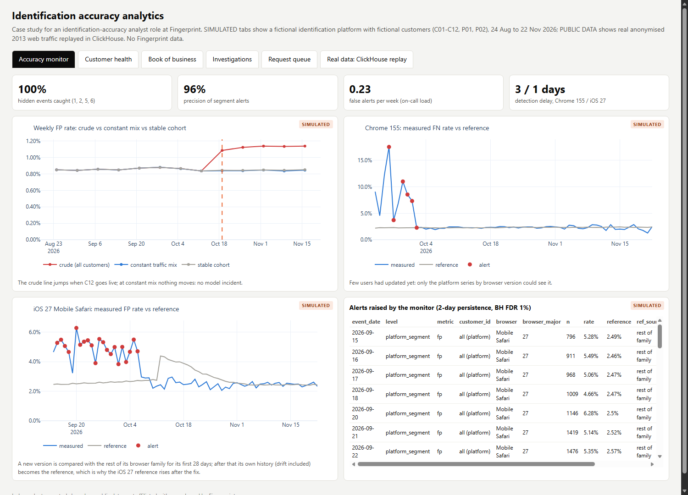

# Is it the model, the mix or the measurement? Identification-accuracy analytics for Fingerprint

### 📄 [Read the report (PDF, 11 pages)](https://albt-france.github.io/fingerprint-identification-accuracy-case-study/report/Fingerprint_identification_accuracy.pdf) &nbsp;·&nbsp; 📊 [Open the interactive dashboard](https://albt-france.github.io/fingerprint-identification-accuracy-case-study/dashboard/)

An independent case study for a **Data Analyst, Identification Accuracy** role at Fingerprint: Fingerprint's published
accuracy method replayed on **100M real events in ClickHouse**, then 13 weeks of a **simulated**
identification platform run end to end: monitoring, customer investigations, reconciliation, self-service tools
(including a read-only MCP server), dbt, playbooks and on-call.

> **PUBLIC DATA** = real public sources. **SIMULATED** = a fictional identification platform with fictional customers
> (C01-C12, prospects P01, P02). No internal Fingerprint data is used or invented; no accuracy figure is attributed to Fingerprint.
> Independent case study based on public data · not affiliated with or endorsed by Fingerprint.

**Also**: [dbt documentation](https://albt-france.github.io/fingerprint-identification-accuracy-case-study/dbt-docs/) ·
[health reports](report/health_reports/) · [book of business](report/book_of_business/) ·
[playbooks](docs/playbooks/) · [MCP server](tools/mcp_server/README.md) · [metrics dictionary](METRICS.md) ·
[notebook](notebooks/fingerprint_identification_accuracy.ipynb)

## Key results

| | Result | Data |
|---|---|---|
| 1 | Replaying the control / test method on 67M real events, the **grain** alone moves the false-positive share from **36%** (every page view) to **78%** (one attempt per visit). An identification request is closer to a visit. | PUBLIC DATA |
| 2 | The same replay in **DuckDB and ClickHouse** gives **0** difference on 67 sites (1,514,013 events, 6 measures, 2 grains). | PUBLIC DATA |
| 3 | A **+30%** weekly jump in false positives is **pure mix** (a mobile-heavy customer goes live): at constant traffic mix the rate moves +0.4%, and existing customers changing significantly week over week: 0. No model incident. | SIMULATED |
| 4 | The monitor catches **100%** of the hidden drift, robot and pipeline events (Chrome 155 in 3 days, iOS 27 in 1) at **0.23** false alerts per week. | SIMULATED |



## What an identification-accuracy analyst delivers here

| Mission (job post) | Deliverable | Where |
|---|---|---|
| First point of contact for reported false positives / negatives | 6 investigation playbooks, 3 customer explainers in plain language | `docs/playbooks/`, `docs/customer_explainers/` |
| Analyses for strategic customers and prospects, custom metrics from account ids | C07 accounts-per-visitor without internal traffic (rule precision 100%, recall 100% vs simulated truth), P01 POC robot segmentation, C09 measurement bias | report page 7, `mart_linked_id_metrics` |
| Dashboards: per-customer health, weekly book of business | weekly health status (rules in METRICS.md), 4 printable health reports, digest per CSM pod (never sent automatically) | `tools/health_report.py`, `tools/book_of_business.py`, dashboard |
| Self-service and AI-assisted tools, adoption | CLI and **read-only MCP server** (5 whitelisted tools, tested without any LLM); 57% of the 140 simulated requests were self-servable | `tools/`, `docs/self_service_adoption.md` |
| dbt on ClickHouse: aggregates, incremental models, tests | 23 models, 62 data tests, 2 unit tests, source freshness, incremental model with a 3-day lookback (replayed day by day around a late partition), portability macros; ClickHouse DDL (AggregatingMergeTree, materialized views) checked with `EXPLAIN AST` | `dbt/`, `clickhouse/` |
| Monitoring, anomaly detection, time series | exact tests with over-dispersion, Benjamini-Hochberg, 2-day persistence, Laney p'-chart, CUSUM; back-tested | `src/monitoring.py`, report page 6 |
| Reconcile with a customer's analysis; prioritise a request queue | C03 bridge (+9.8% explained: blocked requests, time zone, residual 0.16%); impact x urgency triage | `docs/playbooks/customer_reconciliation.md`, `docs/request_triage.md` |
| Document findings and procedures; shared on-call | on-call runbook, data issues log, statistics notes | `docs/` |

## Methods

- **Real part**: ClickBench `hits` (anonymised July 2013 web-analytics events) queried on the public read-only ClickHouse
  playground (34 of 150 allowed queries, aggregates only, results cached with their SQL); an
  illustrative 16-attribute fingerprint, exact and tolerant variants, event / visit / day grains, robots, a calibrated
  confidence score evaluated out of sample, a bound on cookie churn, a real version roll-out. Real release calendars
  (Chrome, Firefox, iOS) and Wikimedia adoption curves and unique-device counts.
- **Simulated part**: 15.5M identification events, 12 customers and 2 prospects, 13 weeks, a hidden true device per
  event, Fingerprint-style measurement (control = deterministic answer, test = same event without it), 8 hidden events,
  every assumption in [`docs/assumptions.md`](docs/assumptions.md).
- **Statistics**: Wilson intervals, cluster bootstrap by visitor, quasi-binomial tests, minimal detectable effect, direct
  standardization, Benjamini-Hochberg, control charts, calibration ([`docs/statistics_notes.md`](docs/statistics_notes.md)).
- **Rule**: every number of the report, the README and the dashboard is read from `data/processed/findings.json`.
- AI-assisted workflow: I used Claude, mainly to write scripts faster. I drove the project: I defined the questions, chose and validated the data sources, made the analytical decisions and checked every result.

## How to rerun

```
python -m venv .venv
.venv\Scripts\activate
pip install -r requirements.txt
python src/fetch_public.py              # uses the cache in data/raw when present
python src/clickhouse_play.py --all     # uses the cache: no query is sent if the SQL did not change
python src/simulate_platform.py         # seed 42, about 4 minutes
cd dbt && dbt build --profiles-dir . && cd ..
python src/monitoring.py
python src/incremental_replay.py        # day-by-day dbt runs around the late partition
python src/findings.py
pytest
python tools/health_report.py --customer C07
python tools/book_of_business.py --week 2026-11-16
python src/build_dashboard.py
jupyter nbconvert --to notebook --execute --inplace notebooks/fingerprint_identification_accuracy.ipynb
python src/build_pdf.py
python src/build_readme.py
```
The whole chain: `python src/run_all.py` (logged) or the Prefect 3 flow `python pipelines/flow.py` (local, no server).
dbt documentation: `cd dbt && dbt docs generate --profiles-dir .` (static copy in `dbt-docs/`).

## Superset

One installation attempt on Windows (not officially supported) in a separate environment, with a local admin whose random
password lives only in `.env`: it worked. Four charts and a dashboard were created by `bi/superset/build_superset.py`,
each chart queried through the Superset API (all returned data), and the dashboard exported as an import bundle
(`bi/superset/export/`, importable in Preset; database path replaced by a placeholder). Datasets exist in ClickHouse and
DuckDB dialects (`bi/superset/datasets/`), the full specification with alerts and roles is in
[`bi/superset/dashboard_spec.md`](bi/superset/dashboard_spec.md), screenshots in `bi/superset/screenshots/`.

## Sources and licences

- ClickBench `hits` (ClickHouse/ClickBench repository, **CC BY-NC-SA 4.0**): published aggregates are shared under the same licence, with attribution.
- Chromium Dash, Mozilla product-details, endoflife.date; Wikimedia Foundation published datasets and Analytics API (CC0).
- Fingerprint: job post and careers list (Greenhouse API), public documentation (identification accuracy and confidence, identify visitors, MCP server), GitHub API. Read on 2026-11-23.
- Details: [`data/README.md`](data/README.md).

## Limits

- The real data is from 2013, obfuscated, from a web-analytics service, with 17 of 31 days present; the
  16-attribute exact match is a teaching device, **not Fingerprint's algorithm**, and its accuracy level means nothing for
  a modern product. The cookie used as truth can be cleared (bounded in the report).
- No local ClickHouse (no Docker or WSL on the machine used): ClickHouse SQL ran on the public playground; dbt runs on
  DuckDB with ClickHouse portability macros; the optional `dbt-clickhouse` compile was not attempted (it would only render
  Jinja and spend playground queries).
- The simulated platform, its customers, error rates, ARR and requests are fictional.
- Device identification is personal data under the GDPR (legal basis, fraud-prevention purpose, minimisation): see
  [`docs/privacy_and_ethics.md`](docs/privacy_and_ethics.md). Nothing here explains how to evade identification or robot detection.
